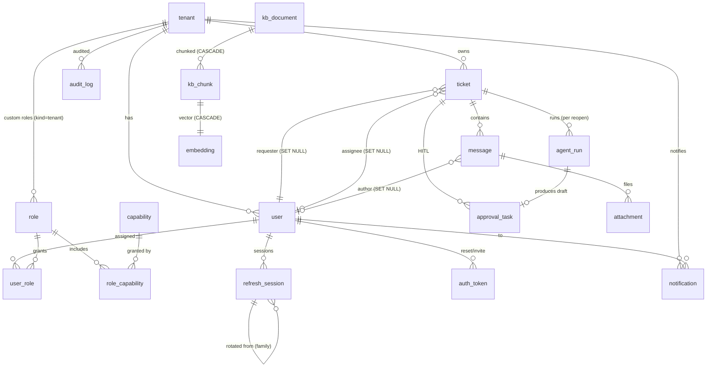

# Spec — Modelo de datos (entidades, ERD, RLS)

> Fuente de verdad del modelo de datos de Syntax. La materializa **08** (modelos SQLAlchemy +
> migraciones Alembic + políticas RLS), la consumen **06** (schemas de la API), **10/18** (servicios de
> dominio y scheduler SLA) y **13/14/15/16** (ingestión, retriever, grafo). Se apoya en **02**
> (`rbac.md`) para capacidades/roles/ámbitos y visibilidad de mensajes. **Este fichero es la spec, no el
> código**: aquí van entidades, relaciones, enums, índices, marca de RLS y política de borrado; la
> creación de tablas/migraciones es 08.
>
> **SDD** — Doc de **referencia** (detalle técnico) de la capa SDD. Requisitos en [`spec.md`](./spec.md);
> aislamiento en [ADR-0006](../adr/0006-aislamiento-multi-tenant-app-level-mas-rls.md); flujos en
> [CU-BE-04](./casos-de-uso/CU-BE-04-ciclo-de-vida-del-ticket.md) y
> [CU-BE-09](./casos-de-uso/CU-BE-09-administracion-tenants-usuarios-roles.md).

## 1. Convenciones

- **PK**: `id` `UUID` (v4) en todas las tablas salvo las de unión, que usan PK compuesta natural.
- **Timestamps**: `created_at`/`updated_at` (`timestamptz`, UTC) en toda entidad de primera clase.
- **Tenancy**: las tablas **de negocio** llevan `tenant_id UUID NOT NULL FK→tenant(id)` y están **sujetas
  a RLS** (§6). Las tablas de **KB** son **globales**: sin `tenant_id`, sin RLS (KB compartida read-only,
  decisión de 02 §5). Las tablas de **identidad/RBAC** son cross-tenant de sistema (§6 detalla cuáles).
- **Enums**: se implementan como enum nativo de Postgres (o `CHECK`) — decisión concreta en 08. Los
  **nombres** de §3 son contrato literal: 02 y 06 los referencian tal cual.
- **Nomenclatura**: tablas en `snake_case` singular (`ticket`, `role_capability`).

## 2. Grupos de entidades

| Grupo | Tablas | `tenant_id` + RLS | Notas |
|---|---|:--:|---|
| Identidad / RBAC | `tenant`, `user`, `user_tenant`, `capability`, `role`, `role_capability`, `user_role`, `refresh_session`, `auth_token` | — (§6) | Cross-tenant de sistema; el ámbito lo da el RBAC (02), no RLS de fila. `user_tenant` es la membership (11). |
| Negocio | `ticket`, `message`, `attachment`, `approval_task`, `agent_run`, `audit_log`, `notification` | ✅ | Toda fila pertenece a un tenant. |
| KB (global) | `kb_document`, `kb_chunk`, `embedding` | ❌ | Documentación de Syntax, compartida sin RLS de tenant. |

## 3. Enums (contrato — coherente con 02 y 06)

| Enum | Valores | Usado en |
|---|---|---|
| `capability_scope` | `tenant` · `global` | `capability.scope` (02 §1) |
| `role_kind` | `system` · `tenant` | `role.kind` (roles semilla inmutables vs custom por tenant, 02 §3-4) |
| `user_status` | `invited` · `active` · `disabled` | `user.status` (soft-delete = `disabled`; `invited` para el flujo B.3) |
| `tenant_status` | `active` · `disabled` | `tenant.status` (soft-disable; no hard-delete, §7) |
| `ticket_status` | `new` · `open` · `pending` · `resolved` · `closed` · `reopened` | `ticket.status` |
| `ticket_priority` | `low` · `normal` · `high` · `urgent` | `ticket.priority` (lo fija el clasificador, 05) |
| `message_visibility` | `public` · `internal` | `message.visibility` (02 §6; **sin `developer`**, Fase 2) |
| `approval_status` | `pending` · `approved` · `edited` · `rejected` | `approval_task.status` |
| `agent_run_status` | `queued` · `running` · `succeeded` · `failed` | `agent_run.status` (**`failed`** = fallo del LLM a mitad de run) |
| `kb_estado` | `draft` · `active` | `kb_document.estado` (señal de retrieval con peso explícito, 04; ~218 draft / ~50 active) |
| `kb_domain` | los **17** dominios de la KB (lista abajo) | `kb_document.domain`, `ticket.domain` |
| `auth_token_kind` | `password_reset` · `invitation` | `auth_token.kind` (B.3) |
| `notification_type` | `approval_requested` · `ticket_assigned` · `ticket_reply` · `sla_breach` · `sla_warning` | `notification.type` |

**`kb_domain` (17)**: `analytics-logs-and-activity`, `authoring-and-editor`,
`content-modeling-and-schemas`, `data-collection-and-store`, `data-packs-and-distributors`,
`forms-and-submissions`, `i18n-and-translations`, `identity-and-permissions`,
`integrations-crm-and-feeds`, `media-and-dam`, `navigation-and-menus`, `platform-and-devex`,
`render-infra-and-config`, `rendering-and-publishing`, `search-ai-and-llms`, `seo-sitemaps-and-edge`,
`sites-domains-instances`. (Verificado contra la KB real; `index.md` no cuenta como dominio.)

> `ticket.category` es una etiqueta más fina **libre** (string) que también fija el clasificador (05);
> no se enumera aquí para no acoplar el modelo a la taxonomía del LLM. `ticket.domain` sí es 1-de-17.

## 4. Entidades

### 4.1 Identidad / RBAC (materializa 02; identidad multi-tenant global desde 11/backend-routers-core-01)

- **`tenant`** — cliente = dominio. `id`, `slug` (único; el tenant-sistema es `syntax`), `name`,
  `status` (`tenant_status`), `auto_approve` (bool, default `false` — auto-aprobación HITL del
  tenant, lo configura su admin vía `/admin/settings`; consumidor real: nodo `decide` del grafo,
  tarea 15), timestamps. **No** se hard-borra (§7).
- **`user`** — identidad **GLOBAL** (sin `tenant_id`/`status` propios: un mismo usuario puede
  pertenecer a varios tenants con **una sola contraseña compartida**, decisión de owner). `id`,
  `email` (único **global**, no por tenant), `password_hash` (**argon2**, nullable si ninguna
  membership tiene aún clave fijada), `sso_subject` (nullable, **Fase 2** — hueco para identidad
  federada, 02 §8), timestamps.
- **`user_tenant`** — membership `user`×`tenant` (nueva): el `status` (`user_status`:
  `invited`/`active`/`disabled`) vive AQUÍ, **por tenant**, no en `user`. PK compuesta natural
  (`user_id`, `tenant_id`); `created_at`. Índice por `user_id` (listar membresías de un usuario) y
  por `tenant_id` (listar usuarios de un tenant, `admin_users`). FKs: `user_id`→`user` **CASCADE**
  (borrar el usuario limpia sus membresías); `tenant_id`→`tenant` **RESTRICT** (un tenant con
  membresías no se hard-borra).
- **`capability`** — catálogo (02 §2). `id`, `name` (único, p.ej. `ticket.reply`), `scope`
  (`capability_scope`), `description`. Semilla; **no** editable por tenants.
- **`role`** — `id`, `name`, `kind` (`role_kind`), `tenant_id` (nullable: `NULL` en roles `system`;
  requerido en roles `tenant`), `description`, timestamps. Roles `system` **inmutables** (02 §4).
  Único por (`tenant_id`, `name`).
- **`role_capability`** — unión `role`×`capability`. PK (`role_id`, `capability_id`). Concede la
  capacidad al rol (el ámbito efectivo lo acota el rol y las invariantes de 02 §4).
- **`user_role`** — unión `user`×`role`, con `tenant_id` del ámbito de asignación. PK (`user_id`,
  `role_id`). Un rol `tenant` solo es asignable a usuarios de su tenant (02 §4). Un usuario con roles
  distintos en dos tenants está soportado (`effective_capabilities` se acota por `(user_id,
  tenant_id)` — 11, fix de seguridad de `scenario-coverage`).
- **`refresh_session`** — token store del refresh (habilita **rotación + reuse-detection + logout
  server-side**, A1.5). `id`, `user_id` FK→`user`, **`tenant_id`** FK→`tenant` **RESTRICT** (una
  sesión de refresh es de un tenant CONCRETO — el elegido en `select_tenant`/`switch_tenant` cuando
  el usuario tiene 2+ membresías, 11), `token_hash` (único; se guarda el hash, no el token),
  `family_id` (UUID de la cadena de rotación), `parent_id` (nullable, FK→`refresh_session`), `status`
  (`active`/`rotated`/`revoked`), `expires_at`, `created_at`, `last_used_at`, `user_agent`/`ip`
  (opcionales). **Reuse-detection**: si llega un token ya `rotated`/`revoked`, se revoca **toda la
  `family_id`** (logout global de esa cadena).
- **`auth_token`** — tokens de un solo uso de **password-reset** e **invitación** (B.3). `id`, `user_id`
  FK→`user`, `kind` (`auth_token_kind`), `token_hash` (único), `expires_at`, `used_at` (nullable),
  `created_at`. Email en **stub** en Fase 1 (fuera de alcance el envío real). **Limitación conocida**:
  no lleva `tenant_id` — con invitaciones simultáneas a varios tenants para el mismo usuario,
  `accept_invitation` activa TODAS las membresías `invited` del usuario, no solo la del token
  (documentado, riesgo de seguridad nulo: mismo usuario destinatario en ambos casos).

### 4.2 Negocio (todas con `tenant_id` + RLS)

- **`ticket`** — `id`, `tenant_id`, `subject`, `status` (`ticket_status`), `priority`
  (`ticket_priority`), `domain` (`kb_domain`, lo fija el clasificador), `category` (string libre),
  `requester_id` FK→`user` (**ON DELETE SET NULL**), `assignee_id` FK→`user` nullable (**SET NULL**),
  `sla_due` (`timestamptz`, nullable), `csat` (smallint 1–5, nullable), timestamps.
- **`message`** — `id`, `tenant_id`, `ticket_id` FK→`ticket` (**CASCADE**), `author_id` FK→`user` (SET
  NULL; nullable para mensajes generados por IA sin autor humano), `visibility` (`message_visibility`),
  `is_ai_draft` (bool), `body`, `created_at`. Un draft IA aprobado se materializa como `message`
  `public` (transición de `approval_task`, ver 06/12).
- **`attachment`** — `id`, `tenant_id`, `message_id` FK→`message` (**CASCADE**), `filename`,
  `content_type`, `size_bytes`, `storage_key` (puerto storage; el binario **no** vive en Postgres),
  `created_at`.
- **`approval_task`** — HITL. `id`, `tenant_id`, `ticket_id` FK→`ticket` (**CASCADE**), `agent_run_id`
  FK→`agent_run` (**CASCADE**), `status` (`approval_status`), `draft_body` (propuesta del agente),
  `final_body` (nullable; lo que se envió si `edited`), `human_note` (nullable), `decided_by` FK→`user`
  (SET NULL), `decided_at` (nullable), `created_at`. **Idempotencia**: una decisión sobre una
  `approval_task` ya no-`pending` es no-op (doble decisión no muta estado; ver 06).
- **`agent_run`** — una ejecución del grafo. `id`, `tenant_id`, `ticket_id` FK→`ticket` (**CASCADE**),
  `langgraph_thread_id` (string; **`ticket_{id}_run_{n}`** — secuencia por reapertura, A1.2),
  `run_seq` (int, `n` de la secuencia), `status` (`agent_run_status`, incl. **`failed`**), `confidence`
  (float 0–1, nullable), `escalated` (bool — confianza insuficiente → nota al humano/escalado),
  `sources` (JSONB — citas: `[{uc_id, chunk_id, score}]`), `error` (nullable; detalle si `failed`),
  `langsmith_trace_url` (nullable), `created_at`, `finished_at` (nullable).
- **`audit_log`** — auditoría de mutaciones. `id`, `tenant_id`, `actor_id` FK→`user` (SET NULL),
  `action` (string), `entity_type`, `entity_id`, `payload` (JSONB, diff/contexto), `created_at`.
  **Append-only** (no update/delete lógicos).
- **`notification`** — in-app (+ polling). `id`, `tenant_id`, `user_id` FK→`user` (**CASCADE**), `type`
  (`notification_type`), `payload` (JSONB), `read_at` (nullable), `created_at`.

### 4.3 KB (global — sin RLS de tenant)

- **`kb_document`** — un UC de la KB. `id`, `uc_id` (**único**, del frontmatter `uc`, p.ej.
  `UC-API-081`), `domain` (`kb_domain`, del frontmatter `domain`), `package` (del frontmatter, p.ej.
  `syntax-api`; **precedencia**: si difiere del `Package` del bloque Trazabilidad, **gana el
  frontmatter** — coord. 04), `estado` (`kb_estado`, del bloque `::: info Trazabilidad`), `title` (del
  frontmatter), `source_url` (**derivado** de la ruta en el repo — el frontmatter **no** trae `url`),
  `traza` (JSONB/array — rutas de código del bloque Trazabilidad), `updated` (`timestamptz`),
  timestamps. **Upsert idempotente por `uc_id`** (04).
- **`kb_chunk`** — trozo de un documento (chunking **H2 tolerante**, 04). `id`, `document_id`
  FK→`kb_document` (**CASCADE**), `section_type` (string **libre** — `comportamiento`/`conceptos`/
  `reglas`/`detalles-qa`/`fidelidad`/`glosario` y variantes; **no** enum rígido, la estructura H2 no se
  asume uniforme), `content`, `token_count` (int), `ordinal` (int, orden dentro del doc), `created_at`.
- **`embedding`** — vector de un chunk. `id`, `chunk_id` FK→`kb_chunk` (**CASCADE**, único 1:1),
  `model` (string — qué modelo lo generó, p.ej. `text-embedding-3-small`), `vector` (`vector(N)`),
  `created_at`. **N = dimensión desde config** (§8), no literal.

## 5. ERD

> El ERD es completo (todas las FK del §4). No hay entidades huérfanas: cada tabla de KB cuelga de
> `kb_document`; cada tabla de negocio cuelga de `tenant` (+ su agregado); identidad cuelga de `tenant`/
> `user`.

## 6. RLS (aislamiento en profundidad)

- **Llevan RLS** (política por `tenant_id`): **todas las de negocio** — `ticket`, `message`,
  `attachment`, `approval_task`, `agent_run`, `audit_log`, `notification`.
- **No llevan RLS de tenant**: KB (`kb_document`, `kb_chunk`, `embedding`) — compartida (02 §5). Las de
  **identidad/RBAC** (`tenant`, `user`, `role`, `capability`, uniones, `refresh_session`, `auth_token`)
  **no** llevan RLS de fila por `tenant_id`: el aislamiento de identidad lo gobierna el RBAC/servicio
  (02); son de sistema y cross-tenant por diseño (Soporte gestiona usuarios de cualquier tenant).
- **Patrón**: cada request fija el contexto con `SET app.tenant_id = <uuid>` en la conexión; las
  políticas filtran `USING (tenant_id = current_setting('app.tenant_id')::uuid)`. El **ámbito `global`**
  de Soporte (02 §5) omite el filtro (o usa el tenant del switcher para escribir en nombre del cliente).
- **Detalle e implementación en 08** — incluye el **aviso de footgun**: `SET app.tenant_id` sobre un
  **pool asyncpg** puede filtrar contexto entre conexiones reusadas → 08 exige **tests de integración**
  que prueben el aislamiento. Aquí solo se marca **qué** tablas la llevan.

## 7. Borrado, retención y cascada

| Relación | On delete | Motivo |
|---|---|---|
| `ticket.requester_id` / `ticket.assignee_id` → `user` | **SET NULL** | Preservar el histórico del ticket si se borra/anonimiza un usuario. |
| `message.author_id` → `user` | **SET NULL** | Ídem; el mensaje sobrevive al autor. |
| `approval_task.decided_by` / `audit_log.actor_id` → `user` | **SET NULL** | Trazabilidad sin bloquear el borrado del actor. |
| `ticket` → `message`/`approval_task`/`agent_run` | **CASCADE** | Son parte del agregado ticket. |
| `message` → `attachment` | **CASCADE** | El adjunto no existe sin su mensaje (borrar `storage_key` es tarea del servicio, no de la FK). |
| `agent_run` → `approval_task` | **CASCADE** | El draft cuelga de su run. |
| `user` → `refresh_session` / `auth_token` / `notification` / `user_tenant` | **CASCADE** | Logout, limpieza y borrado de membresías al borrar el usuario global (11). |
| `kb_document` → `kb_chunk` → `embedding` | **CASCADE** | Re-ingesta/borrado de un UC limpia sus chunks y vectores. |
| `tenant` → cualquier tabla de negocio/usuario | **RESTRICT** | Un tenant **no** se hard-borra; se `disabled` (soft, `tenant_status`). |

- **Soft-delete**: usuarios y tenants se desactivan por `status` (`user_status.disabled` /
  `tenant_status.disabled`), no se hard-borran en el flujo normal. El hard-delete (GDPR) queda para un
  procedimiento explícito que respeta las cascadas/SET NULL de arriba.
- **`audit_log`**: append-only; no se borra por operación de negocio.
- **Retención / GDPR**: **hoy sin política definida** (ventana de retención de tickets/logs, borrado por
  solicitud del interesado, anonimización). Se declara como hueco explícito a resolver antes de
  producción; el modelo (SET NULL + soft-delete) **habilita** la anonimización, no la implementa.

## 8. Dimensión del vector (parametrizable)

- `embedding.vector` es `vector(N)` con **N desde config** (`EMBEDDING_DIM`), **no** literal. Default de
  Fase 1: **1536** (OpenAI `text-embedding-3-small`, decisión del plan). `embedding.model` guarda qué
  modelo lo generó, para detectar mezclas.
- **Coste de cambiar N**: cambiar el modelo/dimensión obliga a **re-embeddear todo el corpus** (migrar
  la columna `vector(N)` y regenerar todos los `embedding`) y **reconstruir el índice** pgvector. No es
  un cambio en caliente: exige migración Alembic + re-ingesta completa (04/13).

## 9. Índices

- **`embedding.vector`**: índice **pgvector** para búsqueda ANN por similitud (coseno). La elección
  **ivfflat vs hnsw** y sus parámetros se fija en 08/14 (hnsw = mejor recall/latencia, más coste de
  build/memoria; ivfflat = más barato, requiere `lists` y `ANALYZE`). Aquí solo se declara que **existe**
  y que se reconstruye al cambiar N (§8).
- `kb_document`: **único** `uc_id`; índice por `domain` (filtro de retrieval, 14).
- `kb_chunk`: índice por `document_id`.
- `ticket`: `(tenant_id, status)`, `(tenant_id, assignee_id)`, `(tenant_id, sla_due)` (scheduler SLA, 18).
- `message`: `(ticket_id, created_at)` (orden determinista del hilo).
- `agent_run`: `(ticket_id, run_seq)`; índice por `langgraph_thread_id`.
- `approval_task`: `(tenant_id, status)` (cola de aprobaciones pendientes).
- `notification`: `(user_id, read_at)`.
- `user`: **único** `email` (**global**, no por tenant, desde 11). `user_tenant`: PK `(user_id,
  tenant_id)`; índice por `user_id` y por `tenant_id`. `refresh_session`: **único** `token_hash`,
  índice `family_id`. `auth_token`: **único** `token_hash`. `user_role`: PK `(user_id, role_id)`. `role`: único
  `(tenant_id, name)`.

## 10. Refuerzos (scenario-coverage) — checklist de cobertura

- **`agent_run.status` incluye `failed`** — §3, §4.2 (`error` guarda el detalle; el ticket no queda en
  estado inconsistente: sin `approval_task` si el run falló).
- **Borrado/retención/cascada** — §7 (SET NULL en `assignee_id`/`requester_id`; CASCADE KB y agregado
  ticket; RESTRICT en `tenant`; soft-delete por `status`; retención/GDPR = hueco explícito).
- **`refresh_session`** — §4.1 (rotación por `family_id`/`parent_id`, reuse-detection revoca la familia,
  logout server-side por revocación; A1.5).
- **Tokens password-reset/invitación** — `auth_token` §4.1 (B.3; email en stub).
- **`thread_id` con secuencia de run** — `agent_run.langgraph_thread_id = ticket_{id}_run_{n}` +
  `run_seq` §4.2 (re-draft tras reopen sin colisionar el checkpoint anterior; A1.2).
- **Precedencia `package` frontmatter vs Trazabilidad** — §4.3 (**gana el frontmatter**; coord. 04).

## 11. Fuera de alcance

- Crear tablas/migraciones/políticas RLS: es **08** (esta spec solo las define).
- Campo/visibilidad `developer` / nota al desarrollador: **Fase 2** diferida (02 §6).
- Política/horario de SLA: solo se **modelan** `priority` + `sla_due`; el cómputo/escalado es 18.
- Parseo fino del frontmatter/Trazabilidad y estrategia de chunking H2: **04** (aquí solo los campos que
  aterrizan en `kb_document`/`kb_chunk`).
